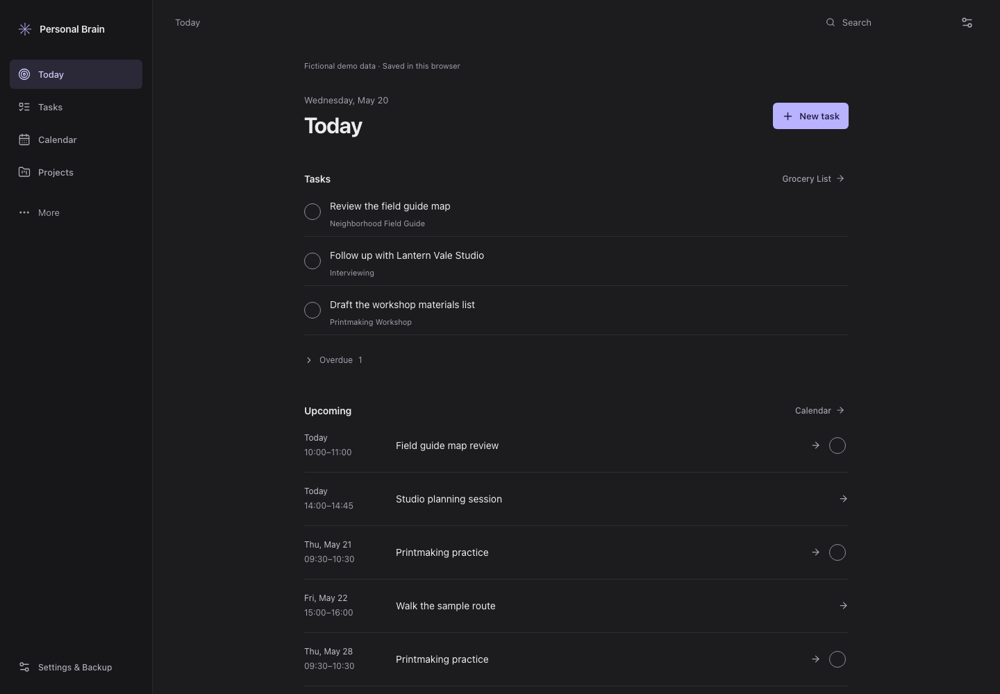
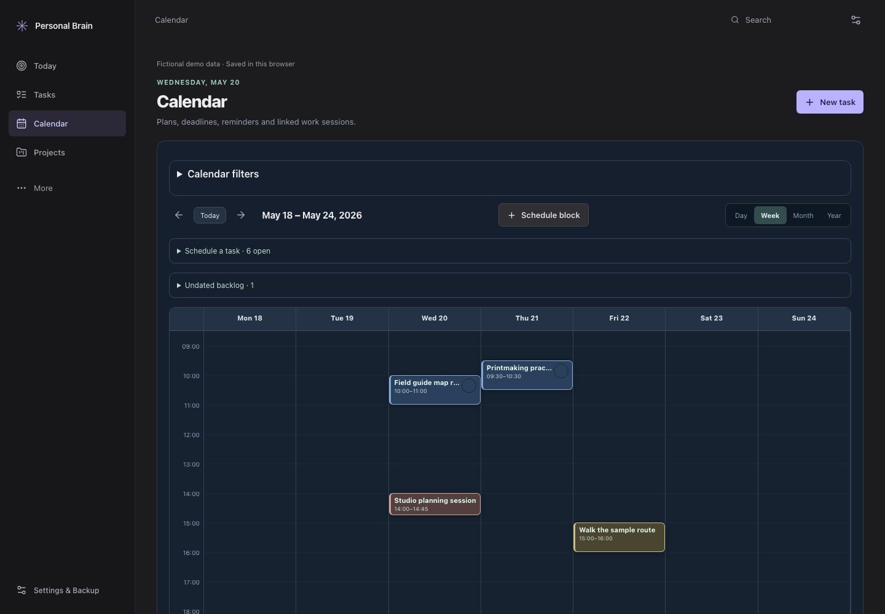
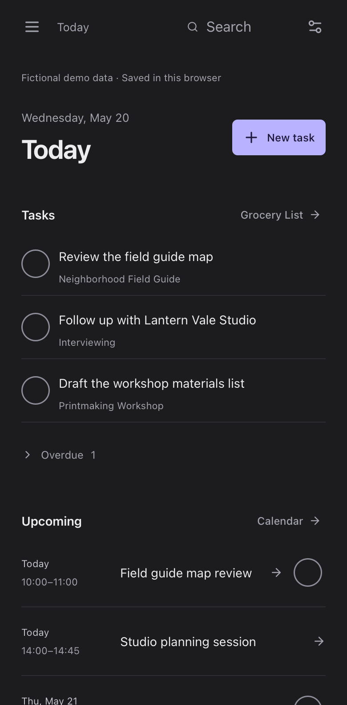
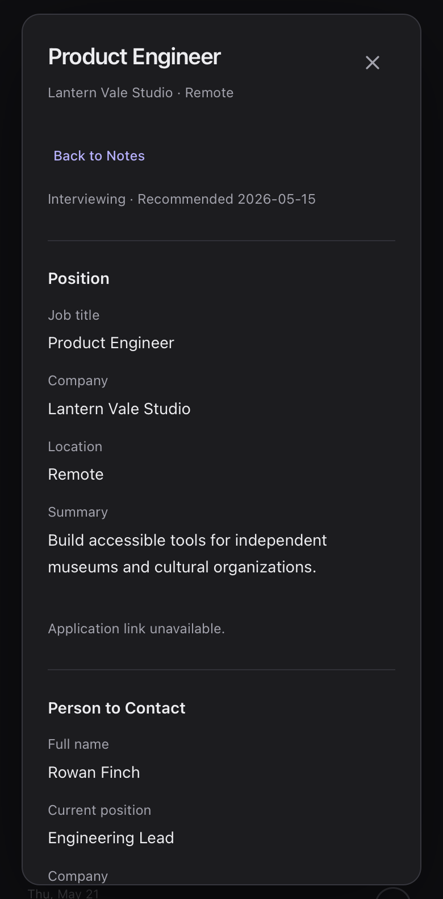
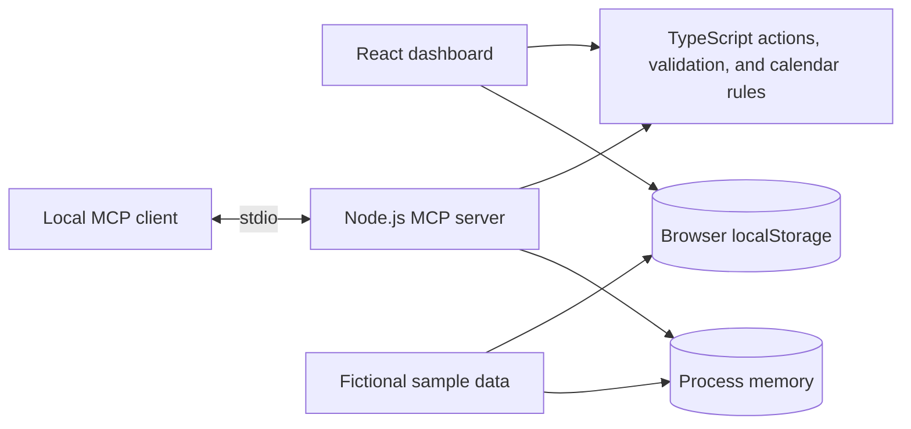

# Personal Brain

Personal Brain is a local-first workspace for planning the day, organizing projects, and turning tasks into time on the calendar.

Task lists tell you what needs doing, and calendars tell you where your time goes. Personal Brain links the two while keeping a task’s deadline, planned day, and scheduled work session independent. This portfolio edition opens with a fictional workspace you can edit and reset.

## Screenshots





| Mobile Today                                                                           | Mobile job details                                                                                   |
| -------------------------------------------------------------------------------------- | ---------------------------------------------------------------------------------------------------- |
|  |  |

## What you can do

- **Today and daily briefing.** See planned work, deadlines, reminders, and the upcoming schedule. The briefing ranks priorities and estimates free time from the current calendar.
- **Tasks and projects.** Capture or search work, add notes and priorities, update project status, complete tasks, and undo the last change.
- **Calendar and planner.** Browse day, week, month, and year views. Drag a task into the time grid or schedule it through a form. Move a linked session without changing the task’s deadline.
- **Recurring blocks.** Set daily, weekly, or selected-weekday schedules for events and linked work sessions. Edit or complete a single occurrence independently of the series.
- **Job applications.** Track a company, role, and application stage on a task. The sample applications include structured details and an example outreach draft.
- **Grocery list.** Add items and store preferences, check off purchases, and reopen or remove items.

## Run locally

Use Node.js 22.18 or later and npm.

```sh
git clone https://github.com/cavigidor/personal-brain-showcase.git
cd personal-brain-showcase
npm ci
npm run dev
```

Open the local URL printed by Vite. The sample dates are relative to the first launch. **Settings & Backup** lets you export or restore a showcase JSON backup and reset to fresh sample data.

## Architecture

The dashboard uses React, TypeScript, and Vite. Calendar calculations use date-fns. The local MCP adapter uses Node.js, the Model Context Protocol SDK, and Zod.



- **Data model.** Projects, tasks, calendar blocks, notes, and grocery items have stable IDs. Work sessions reference tasks and projects. A recurring series expands into dated occurrences, with exclusions and overrides stored alongside the series.
- **State changes.** The domain layer validates a batch before applying it and records a bounded history of changed fields. The browser checks its stored version before writing so a stale tab cannot silently overwrite a newer copy.
- **Automation.** Priority ranking, weekend deadline handling, recurrence, and free-slot suggestions are computed from the workspace on demand.
- **Storage boundaries.** The browser and MCP process start from the same fixtures and hold independent copies. The release has no cloud database, authentication service, external calendar, notification delivery, or background scheduler. Browser edits persist locally and MCP changes reset when its process exits. Recurrence repeats calendar blocks without generating new task records.

### Try the MCP tools

Run the server under a local MCP client using the `stdio` transport, with `node` as the command and the absolute path to `server/mcp.mjs` as its argument. You can also start the server process with `npm run mcp`.

Read tools list projects, tasks, calendar occurrences, and groceries. Write tools create or complete demo tasks and add grocery items. Read the current revision before sending a change. Use that value for `expected_revision` and a UUID for `request_id`. Retrying the same successful request returns its receipt while it remains in the process cache.

## Verification

```sh
npm run typecheck
npm run lint
npm test
npm run build
npx playwright install chromium webkit
npm run test:browser
```

The Node.js suite covers scheduling, data validation, backup format, and MCP calls against a real subprocess. Playwright exercises the production build in desktop Chromium and iPhone-sized WebKit, including task edits, undo, reloads, recurrence overrides, grocery updates, backup and restore, and the absence of external requests. GitHub Actions runs both suites.
